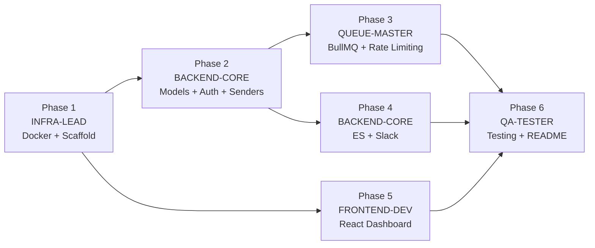

# 👥 CREW INSTRUCTIONS — Gmail Scheduler

> **Project:** Gmail Scheduler (ReachInbox Full-Stack Email Job Scheduler)  
> **Supervisor:** Coordinator AI (Lead Architect)  
> **Date:** 2026-11-25  
> **Status:** 🟢 **CREW DEPLOYMENT READY — BEGIN WORK**

---

## 📢 ATTENTION ALL CREW MEMBERS

> [!IMPORTANT]
> Before starting ANY work, you **MUST** read these documents in order:
> 1. [MASTER_PROMPT.md](file:///e:/Antigravity%20project/Web%20Development/Gmail-Scheduler/docs/MASTER_PROMPT.md) — Full project requirements
> 2. [ARCHITECTURE.md](file:///e:/Antigravity%20project/Web%20Development/Gmail-Scheduler/docs/ARCHITECTURE.md) — System architecture & schema
> 3. [SYSTEM_DESIGN.md](file:///e:/Antigravity%20project/Web%20Development/Gmail-Scheduler/docs/SYSTEM_DESIGN.md) — Component-level design specs
> 4. This document — Your specific assignment
>
> **Log every significant action** in [WORK_LOG.md](file:///e:/Antigravity%20project/Web%20Development/Gmail-Scheduler/docs/WORK_LOG.md)

---

## 🏢 Team Structure

| Role | Codename | Responsibility | Phase |
|------|----------|---------------|-------|
| **Supervisor** | `COORDINATOR` | Architecture review, code review, conflict resolution, final sign-off | All |
| **Crew Member 1** | `INFRA-LEAD` | Docker Compose, monorepo scaffold, project initialization | Phase 1 |
| **Crew Member 2** | `BACKEND-CORE` | Express.js server, Sequelize models, auth, routes, controllers | Phase 2-4 |
| **Crew Member 3** | `QUEUE-MASTER` | BullMQ queue, worker, rate limiting, startup recovery | Phase 3 |
| **Crew Member 4** | `FRONTEND-DEV` | React dashboard, all components, Tailwind styling | Phase 5 |
| **Crew Member 5** | `QA-TESTER` | Testing, verification, README, documentation | Phase 6 |

---

## 📋 CREW MEMBER 1: INFRA-LEAD

### Assignment: Infrastructure & Project Scaffolding (Phase 1)

**Priority:** 🔴 CRITICAL — Must complete FIRST before all other phases

#### Tasks:

- [ ] **T1.1** Create `docker-compose.yml` at project root with:
  - PostgreSQL 16 Alpine (`pg_data` volume, port 5432)
  - Redis 7 Alpine with `--appendonly yes --save 60 1` (`redis_data` volume, port 6379)
  - Elasticsearch 8.15.0 single-node, security disabled (`es_data` volume, port 9200)

- [ ] **T1.2** Initialize backend monorepo:
  ```bash
  mkdir -p backend/src/{config,models,queues,services,controllers,routes,middleware}
  cd backend && npm init -y
  ```

- [ ] **T1.3** Install backend dependencies:
  ```bash
  npm install express cors dotenv cookie-parser
  npm install bullmq ioredis
  npm install @bull-board/api @bull-board/express
  npm install sequelize pg pg-hstore
  npm install @elastic/elasticsearch
  npm install nodemailer
  npm install passport passport-google-oauth20 jsonwebtoken
  npm install uuid
  ```

- [ ] **T1.4** Create `backend/.env.example` with all required environment variables (see MASTER_PROMPT)

- [ ] **T1.5** Initialize frontend:
  ```bash
  npm create vite@latest frontend -- --template react
  cd frontend && npm install
  npm install -D tailwindcss @tailwindcss/vite
  npm install axios papaparse react-router-dom react-hot-toast
  ```

- [ ] **T1.6** Configure `frontend/vite.config.js` with API proxy to `localhost:5000`

- [ ] **T1.7** Create basic `backend/src/server.js` skeleton (Express app with CORS, cookie-parser, dotenv)

- [ ] **T1.8** Create basic `backend/src/worker.js` skeleton (empty BullMQ worker)

- [ ] **T1.9** Add `backend/package.json` scripts:
  ```json
  {
    "scripts": {
      "dev": "node src/server.js",
      "worker": "node src/worker.js",
      "dev:all": "concurrently \"npm run dev\" \"npm run worker\""
    }
  }
  ```

- [ ] **T1.10** Verify Docker Compose services start: `docker-compose up -d`

#### Deliverables:
- Working Docker Compose with all 3 services running
- Backend and frontend project scaffolds with all dependencies installed
- `.env.example` with documentation
- Basic server and worker skeletons

#### Definition of Done:
✅ `docker-compose up -d` starts PG, Redis, ES without errors  
✅ `cd backend && npm run dev` starts Express on port 5000  
✅ `cd frontend && npm run dev` starts Vite on port 5173  
✅ All directories match the monorepo structure in MASTER_PROMPT

---

## 📋 CREW MEMBER 2: BACKEND-CORE

### Assignment: Express.js API, Models, Auth & Services (Phase 2 + 4)

**Priority:** 🟠 HIGH — Depends on Phase 1 completion

#### Phase 2 Tasks:

- [ ] **T2.1** Implement `config/db.js` — Sequelize connection via `DATABASE_URL`
- [ ] **T2.2** Implement `config/redis.js` — ioredis connection with `maxRetriesPerRequest: null`
- [ ] **T2.3** Implement `config/elastic.js` — Elasticsearch client
- [ ] **T2.4** Implement `config/passport.js` — Google OAuth 2.0 strategy
- [ ] **T2.5** Implement all 4 Sequelize models:
  - `models/User.js` — UUID PK, google_id UNIQUE, email UNIQUE
  - `models/Sender.js` — UUID PK, belongsTo User, Ethereal SMTP fields, hourly_limit
  - `models/SlackIntegration.js` — UUID PK, belongsTo User (UNIQUE FK), webhook_url, is_active
  - `models/EmailJob.js` — UUID PK, belongsTo User + Sender, status ENUM, idempotency_key UNIQUE
- [ ] **T2.6** Implement `middleware/authMiddleware.js` — Verify JWT from HTTP-only cookie
- [ ] **T2.7** Implement `controllers/authController.js` — Google login callback, /me, /logout
- [ ] **T2.8** Implement `controllers/senderController.js` — List senders, create Ethereal account
- [ ] **T2.9** Implement `services/mailerService.js` — Nodemailer transport cache per sender, Ethereal account creation
- [ ] **T2.10** Wire up `routes/authRoutes.js` and `routes/senderRoutes.js`

#### Phase 4 Tasks:

- [ ] **T4.1** Implement `services/elasticService.js`:
  - `indexEmailDoc(job)` — Index email document
  - `updateEmailDoc(job)` — Update status/sent_at/preview_url
  - `searchEmails({ userId, query, status })` — Bool query with multi_match + term filters
- [ ] **T4.2** Implement `controllers/emailController.js`:
  - `scheduleEmails` — POST /api/emails/schedule (call scheduleService)
  - `getScheduled` — GET /api/emails/scheduled (paginated)
  - `getSent` — GET /api/emails/sent (paginated)
  - `searchEmails` — GET /api/emails/search (Elasticsearch)
- [ ] **T4.3** Implement `controllers/slackController.js`:
  - `connect` — Redirect to Slack OAuth v2 authorize URL
  - `callback` — Exchange code, upsert slack_integrations
  - `status` — Return connection status
  - `disconnect` — Set is_active = false
- [ ] **T4.4** Implement `services/slackService.js`:
  - `notifySlackRateLimit({ userId, senderId, limit, hourKey })` — Fetch webhook, check Redis dedupe lock, POST alert
- [ ] **T4.5** Wire up all remaining routes in `server.js`

#### Technical Constraints:
- **JWT Cookie:** `httpOnly: true`, `secure: process.env.NODE_ENV === 'production'`, `sameSite: 'lax'`, `maxAge: 7 * 24 * 60 * 60 * 1000`
- **Sequelize:** Use `sync({ alter: true })` in development for auto-migration
- **Ethereal:** Use `nodemailer.createTestAccount()` for new senders; cache `nodemailer.createTransport()` per senderId
- **Slack Dedupe:** `SET slack:alerted:<senderId>:<hourKey> 1 NX EX 3600`

#### Deliverables:
- All 4 Sequelize models syncing correctly
- Google OAuth login/logout working end-to-end
- Ethereal sender creation and listing
- Elasticsearch indexing and search
- Slack OAuth connect/disconnect/notify
- All REST routes operational

---

## 📋 CREW MEMBER 3: QUEUE-MASTER

### Assignment: BullMQ Queue, Worker & Rate Limiting (Phase 3)

**Priority:** 🟠 HIGH — Depends on Phase 1 & 2 (models)

#### Tasks:

- [ ] **T3.1** Implement `queues/emailQueue.js`:
  ```javascript
  const { Queue } = require('bullmq');
  const connection = require('../config/redis');
  const emailQueue = new Queue('email-queue', { connection });
  module.exports = { emailQueue };
  ```

- [ ] **T3.2** Implement `queues/bullBoard.js`:
  - Create `BullMQAdapter` and `ExpressAdapter`
  - Set base path `/admin/queues`
  - Export `serverAdapter` for mounting in `server.js`

- [ ] **T3.3** Implement `services/scheduleService.js`:
  - `scheduleBatch({ userId, senderId, recipients, subject, body, startTime, delayMs, hourlyLimit })`
  - Calculate `targetMs = baseMs + i * minDelay` for each recipient
  - Create EmailJob in PG with `idempotency_key`
  - Generate `bull_job_id = email-${jobRow.id}` (NO COLONS!)
  - Add to emailQueue with calculated delay, 3 attempts, exponential backoff
  - Index in Elasticsearch

- [ ] **T3.4** Implement `worker.js` with FULL rate limiting logic:
  - Worker with configurable `concurrency` from env
  - Idempotency guard: skip if `record.status === 'SENT'`
  - Atomic Redis INCR on `ratelimit:<senderId>:<YYYYMMDDHH>`
  - Set TTL 3700s on first increment
  - If over limit: DECR, Slack alert, compute next hour + stagger, `moveToDelayed()`, `throw new DelayedError()`
  - If under limit: send via Ethereal, update PG → SENT, update ES
  - Handle worker events: `completed`, `failed`, `error`

- [ ] **T3.5** Implement `services/rateLimitService.js`:
  - `getHourKey(date)` — Format as `YYYYMMDDHH`
  - `checkAndIncrement(senderId)` — Atomic INCR + TTL
  - `decrementCounter(senderId)` — Restore accuracy on rate-limit hit
  - `computeOverflowDelay(senderId, minDelay)` — Next hour + stagger offset

- [ ] **T3.6** Implement `services/recoveryService.js`:
  - `reconcilePendingJobs()` — On Express startup:
    1. Query PG for `status IN ('SCHEDULED', 'DELAYED_RATE_LIMIT')`
    2. For each: check `emailQueue.getJob(row.bull_job_id)`
    3. If job missing from Redis: re-enqueue with same jobId and remaining delay
    4. Log recovery actions

- [ ] **T3.7** Mount Bull Board in `server.js` and verify at `/admin/queues`

- [ ] **T3.8** Test burst scenario: schedule 20 emails with hourlyLimit=5, verify correct cascading

#### Critical Code Reference:
```javascript
// getHourKey helper
function getHourKey(date = new Date()) {
  return date.toISOString().slice(0, 13).replace(/[-T:]/g, ''); // e.g. 2026112514
}

// Worker rate-limit + reschedule pattern
if (currentCount > limit) {
  await redis.decr(rateKey);
  await notifySlackRateLimit({ userId, senderId, limit, hourKey });
  const nextHour = new Date();
  nextHour.setUTCMinutes(0, 0, 0);
  nextHour.setUTCHours(nextHour.getUTCHours() + 1);
  const overflowKey = `overflow:${senderId}:${getHourKey(nextHour)}`;
  const overflowIdx = await redis.incr(overflowKey);
  if (overflowIdx === 1) await redis.expire(overflowKey, 7200);
  const nextRunMs = nextHour.getTime() + (overflowIdx - 1) * minDelay;
  await record.update({ status: 'DELAYED_RATE_LIMIT', scheduled_at: new Date(nextRunMs) });
  await updateEmailDoc(record);
  await job.moveToDelayed(nextRunMs, token);
  throw new DelayedError();
}
```

#### Deliverables:
- Working BullMQ queue with delayed job scheduling
- Worker with full rate limiting and overflow rescheduling
- Bull Board accessible at `/admin/queues`
- Startup recovery system
- Zero duplicate sends across restarts

---

## 📋 CREW MEMBER 4: FRONTEND-DEV

### Assignment: React Dashboard (Phase 5)

**Priority:** 🟡 MEDIUM — Can develop UI in parallel with backend Phases 2-4

#### Tasks:

- [ ] **T5.1** Implement `context/AuthContext.jsx`:
  - Fetch `/api/auth/me` on mount
  - Store `user` state (or null if not authenticated)
  - Provide `login()`, `logout()` functions
  - Redirect to `/login` if unauthenticated

- [ ] **T5.2** Implement `services/api.js`:
  ```javascript
  import axios from 'axios';
  const api = axios.create({
    baseURL: '/api',
    withCredentials: true,
  });
  export default api;
  ```

- [ ] **T5.3** Implement `pages/LoginPage.jsx`:
  - Clean centered layout with app logo
  - "Continue with Google" button → redirect to `/api/auth/google`
  - Redirect to dashboard if already authenticated

- [ ] **T5.4** Implement `components/Header.jsx`:
  - User avatar (circular), full name, email address
  - `SlackConnectButton.jsx` — Shows "Connect Slack" or "Connected (#channel) | Disconnect"
  - Link to Bull Board (`/admin/queues`) opens in new tab
  - Logout button

- [ ] **T5.5** Implement `pages/DashboardPage.jsx`:
  - **Sidebar navigation:** Overview, AI Assistant, Insights (active), Notifications (badge: 2), Settings
  - **Main content:** Dashboard header with "AI Engine: Optimal" badge
  - **System Status card:** Circular ring/donut chart showing status distribution
  - **Efficiency card:** Line chart showing trends (Tue–Fri)
  - **Stats cards:** Time Saved (+124h, ▲ 24% this month), Workflows (42, Active now)
  - `SearchBar.jsx` with 300ms debounce → `/api/emails/search`
  - Tab switcher: Scheduled Emails | Sent Emails
  - `EmailTable.jsx` for each tab
  - "Compose New Email" primary button

- [ ] **T5.6** Implement `components/ComposeModal.jsx`:
  - Sender dropdown (populated from `/api/senders`) + "Create New Sender" button
  - Subject input, Body textarea
  - Start Time picker (`<input type="datetime-local">`)
  - Delay Between Emails (seconds, number input)
  - Hourly Limit (number input)
  - CSV/TXT file uploader:
    - Parse with PapaParse on file select
    - Extract valid unique email addresses
    - Display live "X email addresses detected" counter
  - Schedule button → POST `/api/emails/schedule`
  - Loading state while scheduling
  - Success toast on completion

- [ ] **T5.7** Implement `components/EmailTable.jsx`:
  - Columns: Email, Subject, Scheduled/Sent Timestamp, Status, Preview
  - **Status badges** (color-coded Tailwind pills):
    - `SCHEDULED` → Blue (`bg-blue-100 text-blue-800`)
    - `DELAYED_RATE_LIMIT` → Yellow (`bg-yellow-100 text-yellow-800`)
    - `SENT` → Green (`bg-green-100 text-green-800`)
    - `FAILED` → Red (`bg-red-100 text-red-800`)
  - Ethereal Preview icon (clickable, opens preview URL in new tab) for SENT emails
  - Loading skeletons (animated placeholder rows)
  - `EmptyState.jsx` — Illustrated "no emails" placeholder

- [ ] **T5.8** Implement `components/SearchBar.jsx`:
  - Input with search icon
  - 300ms debounce using `useEffect` + `setTimeout`
  - Optional status filter dropdown
  - Calls `/api/emails/search?q=<query>&status=<status>`

- [ ] **T5.9** Add toast notifications (react-hot-toast):
  - Success: "X emails scheduled successfully!"
  - Error: "Failed to schedule emails. Please try again."
  - Slack: "Slack connected successfully!"

- [ ] **T5.10** Responsive design + polish:
  - Mobile-responsive layout (Tailwind breakpoints)
  - Smooth transitions and hover effects
  - Consistent spacing and typography
  - Match the reference dashboard design style

#### Dashboard Reference Design:

The dashboard should match the OtherSync-style design shown in the reference image:
- Left sidebar with navigation items and icons
- Top header with "Dashboard" title and status badge
- Card-based layout for metrics and charts
- Clean, modern aesthetic with blue accent color

#### Deliverables:
- Fully functional React dashboard matching reference design
- Google login flow working end-to-end
- CSV upload with live email detection counter
- Elasticsearch search with debounce
- Color-coded status badges in email tables
- Loading skeletons and empty states
- Toast notifications
- Responsive layout

---

## 📋 CREW MEMBER 5: QA-TESTER

### Assignment: Testing, Verification & Documentation (Phase 6)

**Priority:** 🟢 NORMAL — Begins after Phases 1-5

#### Tasks:

- [ ] **T6.1** Server Restart Persistence Test:
  1. Schedule 10 emails with future start time
  2. Stop Express server + Worker (Ctrl+C)
  3. Restart both processes
  4. Verify all 10 emails still deliver on time
  5. Verify zero duplicate sends in PostgreSQL
  6. Document results in TESTING_REPORT.md

- [ ] **T6.2** Burst Load & Rate Limiting Test:
  1. Schedule 20 emails with `hourlyLimit=5`, `delayMs=2000`
  2. Verify first 5 emails send in current hour
  3. Verify remaining 15 cascade to next hours correctly
  4. Verify Bull Board shows correct Delayed/Completed counts
  5. Document results

- [ ] **T6.3** Slack Alert Deduplication Test:
  1. Connect Slack
  2. Trigger burst load exceeding hourly limit multiple times
  3. Verify exactly 1 Slack alert per sender per hour
  4. Disconnect Slack and verify no crashes
  5. Document results

- [ ] **T6.4** Elasticsearch Search Test:
  1. Schedule and send multiple emails with varied subjects/recipients
  2. Search by subject keyword
  3. Search by recipient email
  4. Filter by status
  5. Verify results match expected data
  6. Document results

- [ ] **T6.5** OAuth Flow Test:
  1. Test Google login → JWT cookie set → /me returns user
  2. Test logout → cookie cleared → /me returns 401
  3. Test multiple browser tabs (cookie shared)
  4. Document results

- [ ] **T6.6** CSV Upload Test:
  1. Upload CSV with 50 emails → verify count
  2. Upload CSV with duplicate emails → verify dedup
  3. Upload CSV with invalid emails → verify filtering
  4. Upload TXT file with emails → verify parsing
  5. Document results

- [ ] **T6.7** Write comprehensive `README.md`:
  - Project overview
  - Architecture diagram (link to ARCHITECTURE.md)
  - Prerequisites (Docker, Node.js 18+, Google OAuth credentials)
  - Setup steps (docker-compose up, npm install, .env configuration, npm run dev)
  - Demo video link placeholder
  - API documentation summary
  - Assumptions, shortcuts & trade-offs section
  - Known limitations

- [ ] **T6.8** Fill out [TESTING_REPORT.md](file:///e:/Antigravity%20project/Web%20Development/Gmail-Scheduler/docs/TESTING_REPORT.md) with all test results

---

## ⚠️ Rules for All Crew Members

1. **Pure JavaScript only** — No `.ts` or `.tsx` files, no type annotations, no `tsconfig.json`
2. **Follow the monorepo structure** exactly as defined in MASTER_PROMPT
3. **Log your work** in [WORK_LOG.md](file:///e:/Antigravity%20project/Web%20Development/Gmail-Scheduler/docs/WORK_LOG.md) with timestamps
4. **No hardcoded values** — All configuration via `.env`
5. **Handle errors gracefully** — Never crash the server on external service failure
6. **Comment your code** — Explain non-obvious logic (especially rate limiting and idempotency)
7. **Use consistent naming** — camelCase for variables/functions, PascalCase for components/models
8. **Test your work** before marking tasks as complete
9. **Ask the COORDINATOR** if requirements are unclear — don't guess
10. **Respect phase dependencies** — Don't start a phase until its prerequisites are complete

---

## 🚦 Phase Dependencies & Execution Order



> **Note:** Phase 5 (Frontend) can begin in parallel with Phase 2 — the frontend can be developed with mock data while the backend is being built. Wire up real API calls once backend routes are live.

---

## 🎬 5-Minute Demo Script (For Final Submission)

| Time | Demonstration |
|------|---------------|
| 0:00–0:45 | Sign in with Google OAuth, show avatar/name/email, Connect Slack |
| 0:45–1:45 | Compose: upload 5-lead CSV, set schedule (+1 min), 2s delay, 2/hr limit, Schedule → check Bull Board |
| 1:45–3:00 | **Restart Test:** Stop server + worker, restart, verify emails still send on time, zero dupes |
| 3:00–4:15 | **Rate Limit:** 2 emails sent → open Ethereal preview → 3 rescheduled → Slack alert arrives |
| 4:15–5:00 | Search via Elasticsearch, disconnect Slack (no crash), summarize trade-offs |

---

## 🟢 CREW — YOU ARE CLEARED TO BEGIN

**Start with Phase 1 (INFRA-LEAD).** All other crew members: read the documentation while waiting for Phase 1 to complete, then begin your assigned phases as soon as dependencies are met.

**Report progress in** [WORK_LOG.md](file:///e:/Antigravity%20project/Web%20Development/Gmail-Scheduler/docs/WORK_LOG.md).

**Good luck, team. Build it right, build it once.** 🚀
