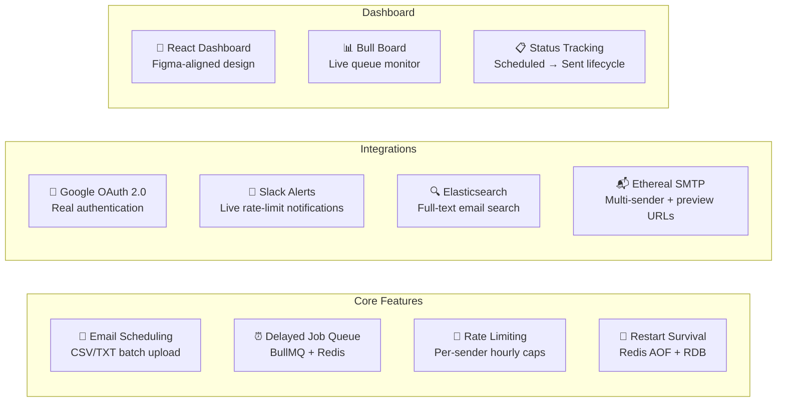
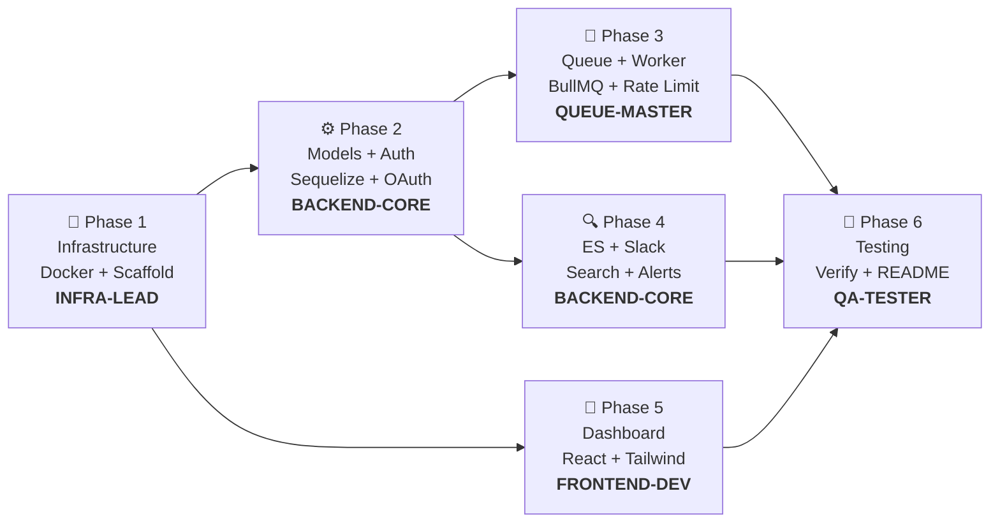

# 📊 PROJECT SUMMARY — Gmail Scheduler

> **Project:** Gmail Scheduler (ReachInbox Full-Stack Email Job Scheduler)  
> **Supervisor:** Coordinator AI (Lead Architect & Project Manager)  
> **Date Created:** 2026-11-25  
> **Status:** 📋 Planning & Documentation Complete — Awaiting Crew Execution

---

## Executive Summary

The **Gmail Scheduler** is a production-grade, full-stack email job scheduling system built entirely in **pure vanilla JavaScript** (Express.js backend + React Vite JSX frontend). It enables users to schedule bulk email campaigns with persistent delayed job queuing, distributed per-sender rate limiting, real-time Slack alerts, Elasticsearch-powered search, and a polished Google-authenticated dashboard — all with zero cron jobs and zero duplicate sends across server restarts.

---

## Project Scope

---

## Technology Stack Summary

| Layer | Technology | Version |
|-------|-----------|---------|
| **Backend** | Express.js (Node.js) | Latest |
| **Frontend** | React (Vite JSX) + Tailwind CSS | Latest |
| **Database** | PostgreSQL | 16 |
| **Queue** | BullMQ + Redis | Redis 7 |
| **Search** | Elasticsearch | 8.15.0 |
| **Auth** | Google OAuth 2.0 + Passport.js | — |
| **Alerts** | Slack OAuth v2 (incoming-webhook) | — |
| **Email** | Nodemailer + Ethereal Email | — |
| **Infra** | Docker Compose | — |
| **Language** | JavaScript (zero TypeScript) | ES2022 |

---

## Project Documentation Map

| Document | Purpose | Status |
|----------|---------|--------|
| [ARCHITECTURE.md](file:///e:/Antigravity%20project/Web%20Development/Gmail-Scheduler/docs/ARCHITECTURE.md) | System architecture, tech stack, DB schema, data flows | ✅ Complete |
| [MASTER_PROMPT.md](file:///e:/Antigravity%20project/Web%20Development/Gmail-Scheduler/docs/MASTER_PROMPT.md) | Comprehensive project requirements for AI crew | ✅ Complete |
| [SYSTEM_DESIGN.md](file:///e:/Antigravity%20project/Web%20Development/Gmail-Scheduler/docs/SYSTEM_DESIGN.md) | Component-level design, security, performance specs | ✅ Complete |
| [CREW_INSTRUCTIONS.md](file:///e:/Antigravity%20project/Web%20Development/Gmail-Scheduler/docs/CREW_INSTRUCTIONS.md) | Team assignments with detailed task checklists | ✅ Complete |
| [WORK_LOG.md](file:///e:/Antigravity%20project/Web%20Development/Gmail-Scheduler/docs/WORK_LOG.md) | Development activity log with phase tracking | ✅ Template Ready |
| [INTERNET_ACCESS_LOG.md](file:///e:/Antigravity%20project/Web%20Development/Gmail-Scheduler/docs/INTERNET_ACCESS_LOG.md) | External resource and API access tracking | ✅ Complete |
| [TESTING_REPORT.md](file:///e:/Antigravity%20project/Web%20Development/Gmail-Scheduler/docs/TESTING_REPORT.md) | 36-test verification plan with checklists | ✅ Template Ready |
| [SUMMARY.md](file:///e:/Antigravity%20project/Web%20Development/Gmail-Scheduler/docs/SUMMARY.md) | This document — project overview | ✅ Complete |

---

## Team Structure

| Role | Codename | Phase | Responsibility |
|------|----------|-------|---------------|
| 🎯 Supervisor | COORDINATOR | All | Architecture review, code review, conflict resolution, final sign-off |
| 🔧 Crew 1 | INFRA-LEAD | Phase 1 | Docker Compose, monorepo scaffold, project initialization |
| ⚙️ Crew 2 | BACKEND-CORE | Phase 2+4 | Express.js server, models, auth, controllers, ES, Slack |
| 🔄 Crew 3 | QUEUE-MASTER | Phase 3 | BullMQ queue, worker, rate limiting, startup recovery |
| 🎨 Crew 4 | FRONTEND-DEV | Phase 5 | React dashboard, all components, Tailwind styling |
| 🧪 Crew 5 | QA-TESTER | Phase 6 | Testing, verification, README, documentation |

---

## 6-Phase Build Roadmap

---

## Key Architectural Decisions

| # | Decision | Alternative Considered | Rationale |
|---|----------|----------------------|-----------|
| 1 | BullMQ delayed jobs | node-cron, Agenda | Native Redis persistence; survives restarts; no external scheduler |
| 2 | Redis AOF + RDB | RDB only | Dual persistence guarantees zero job loss |
| 3 | Separated API + Worker | Monolithic process | Independent scaling; API stays responsive under heavy load |
| 4 | Atomic Redis INCR | In-memory counters | Multi-worker safe; distributed rate limiting |
| 5 | moveToDelayed + DelayedError | Fail + retry | No job dropping; deterministic rescheduling |
| 6 | Custom BullMQ jobId | Auto-generated IDs | Prevents duplicate queueing on re-enqueue |
| 7 | HTTP-only JWT cookie | LocalStorage token | XSS protection; automatic cookie inclusion |
| 8 | Ethereal Email | Real SMTP | Safe testing; clickable preview URLs; no spam risk |
| 9 | PapaParse (client-side) | Server-side CSV parsing | Reduces backend load; instant feedback in UI |
| 10 | Pure JavaScript | TypeScript | Per blueprint requirements; documented as trade-off |

---

## Critical Success Criteria

| # | Criteria | Verification Method |
|---|---------|-------------------|
| 1 | Email scheduling survives server restart with zero duplicates | Restart test (Test 1) |
| 2 | Rate limiting correctly caps per-sender hourly sends | Burst load test (Test 2) |
| 3 | Overflow jobs reschedule to next hour (not dropped or failed) | Bull Board inspection (Test 2) |
| 4 | Slack alert fires exactly once per sender per hour during burst | Dedup test (Test 3) |
| 5 | Elasticsearch search returns correct results with status filtering | Search test (Test 4) |
| 6 | Google OAuth login/logout works end-to-end | OAuth test (Test 5) |
| 7 | CSV upload correctly parses, deduplicates, and counts emails | CSV test (Test 6) |
| 8 | Dashboard matches reference design with all required components | UI test (Test 7) |
| 9 | All 36 tests pass | Testing Report sign-off |
| 10 | README documents setup, architecture, and trade-offs | Manual review |

---

## Risk Assessment

| Risk | Likelihood | Impact | Mitigation |
|------|-----------|--------|------------|
| Redis data loss on crash | Low | High | AOF + RDB dual persistence + startup recovery |
| Duplicate email sends | Low | High | Two-layer idempotency (BullMQ jobId + PG check) |
| Slack webhook failure | Medium | Low | Graceful fallback; no crash on failure |
| Elasticsearch unavailability | Low | Medium | Email still sends; search temporarily unavailable |
| Google OAuth token expiry | Low | Low | JWT refresh on /api/auth/me; re-login flow |
| Rate limit counter inaccuracy | Low | Medium | Atomic Redis operations; DECR on rate-limit hit |

---

## Project Metrics (Post-Completion)

| Metric | Target | Actual |
|--------|--------|--------|
| Total files created | ~40 | — |
| Backend routes | 15 endpoints | — |
| Frontend components | 10+ | — |
| Database tables | 4 | — |
| Test cases | 36 | — |
| Test pass rate | 100% | — |
| Documentation pages | 8 | 8 ✅ |

---

## Next Steps

> [!IMPORTANT]
> **The planning phase is COMPLETE.** The crew should now begin execution following the phase order defined in [CREW_INSTRUCTIONS.md](file:///e:/Antigravity%20project/Web%20Development/Gmail-Scheduler/docs/CREW_INSTRUCTIONS.md).

1. **INFRA-LEAD** → Begin Phase 1 (Docker Compose + scaffold)
2. **All crew** → Read MASTER_PROMPT, ARCHITECTURE, and SYSTEM_DESIGN while waiting
3. **BACKEND-CORE** → Begin Phase 2 when Phase 1 completes
4. **FRONTEND-DEV** → Begin Phase 5 in parallel with Phase 2 (use mock data)
5. **QUEUE-MASTER** → Begin Phase 3 when Phase 2 models are ready
6. **BACKEND-CORE** → Continue to Phase 4 after Phase 2
7. **QA-TESTER** → Begin Phase 6 when Phases 3-5 complete

---

> **Built with ❤️ by the Gmail Scheduler Crew — Supervised by Coordinator AI**
