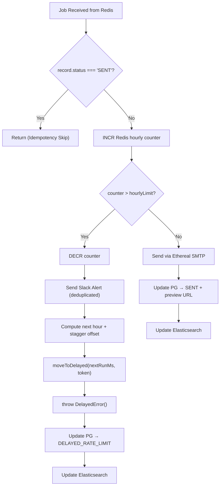
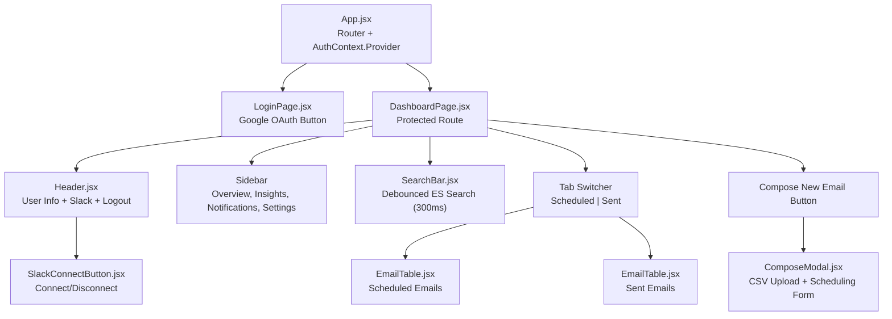
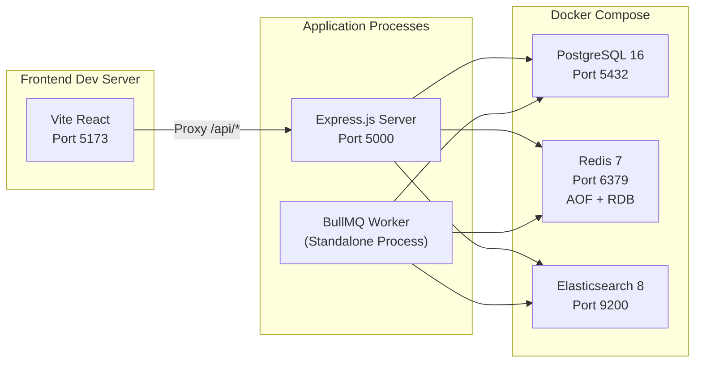

# ⚙️ SYSTEM DESIGN — Gmail Scheduler

> **Project:** Gmail Scheduler (ReachInbox Full-Stack Email Job Scheduler)  
> **Version:** 1.0.0  
> **Date:** 2026-11-25  
> **Lead:** Coordinator AI (Supervisor)

---

## 1. System Overview

The Gmail Scheduler is a **decoupled, event-driven email scheduling system** where the HTTP API layer and the job processing layer operate as independent processes sharing Redis as the coordination backbone. PostgreSQL serves as the durable system of record, while Elasticsearch provides fast full-text search across all email data.

---

## 2. Component Design

### 2.1 Express.js API Server (`server.js`)

**Responsibilities:**
- Mount all REST routes (auth, email, sender, slack)
- Configure Passport.js for Google OAuth 2.0
- Set up JWT cookie-based sessions (HTTP-only, Secure, SameSite=Lax)
- Mount Bull Board at `/admin/queues`
- Run `reconcilePendingJobs()` on startup for crash recovery
- Serve CORS configuration for frontend at `localhost:5173`

**Startup Sequence:**
```
1. Load .env configuration
2. Initialize Sequelize + sync models
3. Connect to Redis (ioredis)
4. Connect to Elasticsearch
5. Configure Passport strategies
6. Mount routes + Bull Board
7. Run reconcilePendingJobs()
8. Listen on PORT (default: 5000)
```

### 2.2 BullMQ Worker (`worker.js`)

**Responsibilities:**
- Process email jobs from `email-queue`
- Enforce idempotency (check PostgreSQL status before sending)
- Enforce rate limits (atomic Redis INCR per sender per hour)
- Reschedule overflow jobs (`moveToDelayed` + `DelayedError`)
- Send Slack alerts on rate-limit breach (deduplicated)
- Send emails via Ethereal SMTP and capture preview URLs
- Update PostgreSQL and Elasticsearch on every state change

**Processing Pipeline:**


### 2.3 Configuration Services

**`config/db.js`** — Sequelize instance connected via `DATABASE_URL`
```javascript
const { Sequelize } = require('sequelize');
const sequelize = new Sequelize(process.env.DATABASE_URL, {
  dialect: 'postgres',
  logging: false,
});
```

**`config/redis.js`** — Shared ioredis connection for BullMQ + rate limiting
```javascript
const IORedis = require('ioredis');
const connection = new IORedis({
  host: process.env.REDIS_HOST,
  port: process.env.REDIS_PORT,
  maxRetriesPerRequest: null, // Required for BullMQ
});
```

**`config/elastic.js`** — Elasticsearch client
```javascript
const { Client } = require('@elastic/elasticsearch');
const elastic = new Client({ node: process.env.ELASTICSEARCH_URL });
```

**`config/passport.js`** — Google OAuth strategy
```javascript
const GoogleStrategy = require('passport-google-oauth20').Strategy;
// Configure with GOOGLE_CLIENT_ID, GOOGLE_CLIENT_SECRET, GOOGLE_CALLBACK_URL
// Find or create user in PostgreSQL on successful auth
```

### 2.4 Sequelize Models

| Model | Key Design Decisions |
|-------|---------------------|
| **User** | `google_id` UNIQUE for OAuth dedup; `email` UNIQUE for account identity |
| **Sender** | Belongs to User; stores Ethereal SMTP credentials; `hourly_limit` per sender |
| **SlackIntegration** | One per user (UNIQUE FK); `is_active` toggle for disconnect/reconnect |
| **EmailJob** | Full lifecycle tracking; `idempotency_key` UNIQUE prevents duplicate scheduling; `bull_job_id` UNIQUE links to BullMQ |

### 2.5 Service Layer Design

| Service | File | Responsibilities |
|---------|------|-----------------|
| **Schedule Service** | `scheduleService.js` | Batch create EmailJobs → index in ES → enqueue in BullMQ with staggered delays |
| **Mailer Service** | `mailerService.js` | Manage Nodemailer transports per sender (cached); send + return preview URL |
| **Rate Limit Service** | `rateLimitService.js` | Atomic INCR/DECR on Redis; check limits; compute overflow stagger |
| **Elastic Service** | `elasticService.js` | Index/update/search email documents in Elasticsearch |
| **Slack Service** | `slackService.js` | Fetch user webhook; POST alert with Redis dedupe lock |
| **Recovery Service** | `recoveryService.js` | Query PG for pending jobs → verify in Redis → re-enqueue missing |

---

## 3. Security Design

### 3.1 Authentication Flow

```
Google OAuth 2.0 → Passport Strategy → User Upsert in PG → JWT Signed
→ Set HTTP-only Cookie (name: "token", maxAge: 7d)
→ Frontend reads /api/auth/me for user data
→ All protected routes check authMiddleware.js (verify JWT from cookie)
```

### 3.2 Security Measures

| Threat | Mitigation |
|--------|-----------|
| XSS token theft | HTTP-only JWT cookie (not accessible via JavaScript) |
| CSRF | SameSite=Lax cookie attribute |
| Credential exposure | All secrets in .env, never committed |
| SQL injection | Sequelize parameterized queries |
| Duplicate sends | Two-layer idempotency (BullMQ jobId + PG status check) |
| Slack alert spam | Redis NX dedupe lock (1 alert per sender per hour) |
| Rate limit bypass | Atomic Redis INCR (safe across multiple workers) |

---

## 4. Frontend Architecture

### 4.1 Component Tree



### 4.2 State Management

| State | Source | Storage |
|-------|--------|---------|
| Auth user | `/api/auth/me` | `AuthContext` (React Context) |
| Email lists | `/api/emails/scheduled`, `/sent` | Component state + refetch on action |
| Search results | `/api/emails/search` | Component state (debounced) |
| Slack status | `/api/slack/status` | Component state |
| Senders | `/api/senders` | ComposeModal local state |
| CSV emails | PapaParse | ComposeModal local state |

### 4.3 Dashboard Design Specifications

The dashboard follows the reference design with:

- **Color Scheme:** Blue primary (#4F46E5), white/gray backgrounds, status-colored badges
- **Layout:** Left sidebar (collapsible) + main content area
- **Typography:** Clean sans-serif, hierarchical sizing
- **Cards:** System Status (ring chart), Efficiency (line chart), Time Saved, Active Workflows
- **Status Badge Colors:**
  - 🟢 Green → Sent / Active
  - 🔵 Blue → Scheduled
  - 🟡 Yellow → Rate Limited / Delayed
  - 🔴 Red → Failed
- **Interactions:** Hover effects, smooth transitions, toast notifications

---

## 5. Data Flow Specifications

### 5.1 Email Scheduling (POST /api/emails/schedule)

**Request Body:**
```json
{
  "senderId": "uuid",
  "recipients": ["a@test.com", "b@test.com"],
  "subject": "Campaign Subject",
  "body": "Email body content",
  "startTime": "2026-11-25T15:00:00Z",
  "delayMs": 2000,
  "hourlyLimit": 200
}
```

**Server Processing (per recipient):**
1. Create `EmailJob` in PostgreSQL (status: `SCHEDULED`)
2. Generate `idempotency_key`: `${userId}-${senderId}-${email}-${baseMs}-${index}`
3. Generate `bull_job_id`: `email-${jobRow.id}` (no colons!)
4. Index in Elasticsearch
5. Add to BullMQ with calculated delay: `Math.max(0, (baseMs + i * minDelay) - Date.now())`

### 5.2 Elasticsearch Document Structure

```json
{
  "id": "job-uuid",
  "user_id": "user-uuid",
  "sender_id": "sender-uuid",
  "recipient_email": "recipient@example.com",
  "subject": "Campaign Subject",
  "body": "Email body",
  "status": "SCHEDULED",
  "scheduled_at": "2026-11-25T15:00:00Z",
  "sent_at": null,
  "ethereal_preview_url": null
}
```

**Search Query (bool):**
- `multi_match` on `["recipient_email", "subject", "body"]`
- `term` filter on `user_id` (mandatory)
- Optional `term` filter on `status`

### 5.3 Slack Alert Payload

```json
{
  "text": "⚠️ Rate Limit Hit: Sender <sender-email> reached hourly limit of <limit> emails during hour <hourKey>. Overflow jobs have been rescheduled to the next hour."
}
```

---

## 6. Error Handling Strategy

| Scenario | Handling |
|----------|---------|
| Ethereal SMTP failure | BullMQ retries 3x with exponential backoff (5s base) |
| Redis connection lost | ioredis auto-reconnects; BullMQ queues buffer |
| PostgreSQL down | 500 error to API; worker pauses until reconnect |
| Elasticsearch unreachable | Log warning; email still sends (search temporarily unavailable) |
| Slack webhook failure | Log error; do not crash; email processing continues |
| Invalid CSV upload | PapaParse returns errors; show in UI; block scheduling |
| Expired JWT | 401 response; frontend redirects to login |
| Duplicate jobId | BullMQ silently ignores (custom jobId dedup) |

---

## 7. Performance Characteristics

| Metric | Target |
|--------|--------|
| API response time (schedule) | < 500ms for 50 recipients |
| Worker throughput | 200 emails/hour/sender (configurable) |
| Search latency | < 100ms for Elasticsearch queries |
| Concurrent workers | 5 (configurable via `WORKER_CONCURRENCY`) |
| Minimum email gap | 2000ms (configurable via `MIN_DELAY_BETWEEN_EMAILS_MS`) |
| Burst handling | 1,000+ emails cascade across hours with zero drops |

---

## 8. Deployment Architecture



---

> **References:**  
> - [ARCHITECTURE.md](file:///e:/Antigravity%20project/Web%20Development/Gmail-Scheduler/docs/ARCHITECTURE.md) — High-level architecture  
> - [MASTER_PROMPT.md](file:///e:/Antigravity%20project/Web%20Development/Gmail-Scheduler/docs/MASTER_PROMPT.md) — Project requirements  
> - [CREW_INSTRUCTIONS.md](file:///e:/Antigravity%20project/Web%20Development/Gmail-Scheduler/docs/CREW_INSTRUCTIONS.md) — Team assignments  
